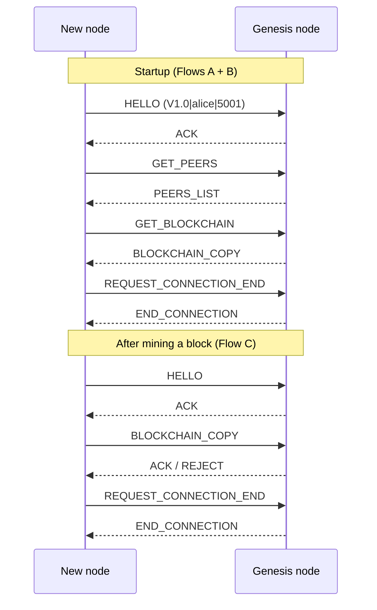

# Blockchain Copy Protocol

A minimal peer-to-peer blockchain written in plain Java. Each node runs a TCP server, keeps its own copy of the chain, mines blocks with a Proof-of-Work algorithm and synchronizes with other nodes through a small custom protocol (**version `V1.0`**).

> ⚠️ This is an educational project. It is meant to demonstrate how a blockchain is built and replicated across nodes, not to be used in production (see [Limitations](#limitations)).

---

## Table of Contents

- [Purpose](#purpose)
- [Dependencies](#dependencies)
- [Project Structure](#project-structure)
- [Getting Started](#getting-started)
- [How It Works](#how-it-works)
  - [Network topology](#network-topology)
  - [Blocks and mining](#blocks-and-mining)
  - [Chain validation and consensus](#chain-validation-and-consensus)
  - [Protocol messages](#protocol-messages)
  - [Protocol flows](#protocol-flows)
- [Configuration](#configuration)
- [Limitations](#limitations)

---

## Purpose

The goal of this project is to implement, from scratch and without external libraries, the core ideas behind a decentralized blockchain network:

- **A chain of blocks** linked by SHA-256 hashes, where each block stores arbitrary text data.
- **Proof-of-Work mining**, where a block is only valid after its hash starts with a given number of zeros.
- **A peer-to-peer network**, where nodes discover each other, exchange peer lists and replicate the blockchain.
- **A "copy protocol"**: a simple request/response protocol over TCP sockets used to copy (synchronize) the blockchain between nodes, following the *longest valid chain wins* rule.

## Dependencies

The project has **no third-party dependencies**. It only uses the Java standard library (`java.net`, `java.io`, `java.security`, `java.util`).

| Requirement | Version | Notes |
|-------------|---------|-------|
| JDK         | **17+** recommended (15 is the minimum) | The code uses text blocks (`"""`, Java 15) and arrow-style `switch` (Java 14+). |
| Build tool  | None required | Can be compiled with plain `javac`. Eclipse project files (`.project`, `.classpath`) are included. |

## Project Structure

```
src/
├── Main.java                 # CLI entry point (GENESIS / NODE / HELP)
├── apps/
│   ├── BaseApp.java          # Shared node logic + interactive console menu
│   ├── GenesisApp.java       # Bootstrap node (first node of the network)
│   └── NodeApp.java          # Regular node that joins through the genesis node
├── blockchain/
│   ├── Block.java            # Block structure, hashing and Proof-of-Work
│   └── BlockChain.java       # Chain storage, validation and update rules
├── config/
│   └── Config.java           # Protocol version and mining difficulty
├── network/
│   ├── Server.java           # Accepts incoming connections (one thread per client)
│   ├── ClientHandler.java    # Handles the protocol on the receiving side
│   ├── Client.java           # Outgoing connection wrapper
│   ├── FlowManager.java      # Implements the protocol flows A, B and C
│   ├── MessageFactory.java   # Helpers to build protocol messages
│   ├── MessageType.java      # Enum with all message types
│   ├── NetworkMessage.java   # Serializable message envelope (type + payload)
│   └── Peer.java             # A peer address (ip:port)
└── utils/
    ├── Logger.java           # Colored console logger that preserves the prompt
    └── StringUtil.java       # SHA-256 helper
```

## Getting Started

### Build

From the project root:

```bash
mkdir -p bin
javac -d bin $(find src -name "*.java")
```

### Run

The first node of the network is the **genesis node**. Every other node needs the address of a node that is already running (normally the genesis one).

```bash
# 1. Start the genesis node on port 5000
java -cp bin Main GENESIS 5000

# 2. Start regular nodes, pointing them at the genesis node
java -cp bin Main NODE alice 5001 127.0.0.1:5000
java -cp bin Main NODE bob   5002 127.0.0.1:5000
```

Command-line patterns:

```
GENESIS [SERVER_PORT]
NODE    [NODE_NAME] [SERVER_PORT] [GENESIS_SERVER_PEER, e.g. 127.0.0.1:5000]
HELP
```

> The first argument and the node name are converted to uppercase when processed.

### Interactive console

Once a node is up, it shows a prompt. Type `h` to list the options:

| Option | Action |
|--------|--------|
| `1` | Inspect this node's blockchain |
| `2` | Inspect this node's known peers |
| `3` | Abort this node's execution |
| `4` | Mine a new block (asks for the block data, then broadcasts the chain) |

### Quick demo

1. Start the genesis node and two regular nodes as shown above.
2. On any node, choose option `4` and type some data (e.g. `hello world`).
3. Wait for the mining to finish. The node broadcasts its chain to every known peer.
4. On the other nodes, choose option `1` — the new block should be there.

## How It Works

### Network topology

- Every node (genesis or regular) runs a TCP **server** and can also open outgoing **client** connections.
- A regular node is given the genesis node's address at startup. It connects to it, asks for its list of peers and for its blockchain.
- Whenever a node receives a valid `HELLO`, it adds the sender to its own peer list. The sender's IP comes from the socket and its listening port from the `HELLO` payload.
- Each incoming connection is handled in its own thread (`ClientHandler`).

### Blocks and mining

Each `Block` contains:

| Field | Description |
|-------|-------------|
| `data` | Arbitrary text payload |
| `previousHash` | Hash of the previous block (`"0"` for the first block) |
| `timestamp` | Creation time in milliseconds |
| `nonce` | Counter incremented during mining |
| `hash` | `SHA-256(previousHash + timestamp + nonce + data)` |

**Mining** increments the `nonce` and recomputes the hash until it starts with `miningDifficulty` zeros (default: `5`). The difficulty must be between 0 and 64.

### Chain validation and consensus

A `BlockChain` is considered valid when, for every block:

1. No field is `null`.
2. The stored `hash` matches the recalculated hash of the block's content.
3. The first block's `previousHash` is `"0"`, and every other block's `previousHash` equals the hash of the block before it.

When a node receives a chain from a peer, it applies a simple **longest-valid-chain** rule:

- Invalid chain → rejected.
- Valid and **longer** than the local chain → local chain is replaced.
- Same chain as the local one → acknowledged ("already up to date").
- Valid but not longer (and different) → rejected.

### Protocol messages

All messages are `NetworkMessage` objects (a `MessageType` plus a payload) exchanged through Java object serialization over TCP.

| Type | Direction | Payload | Description |
|------|-----------|---------|-------------|
| `HELLO` | client → server | `version\|nodeId\|port` | Handshake. Must be the first message of every connection. |
| `ACK` | server → client | text | Positive response. |
| `REJECT` | server → client | reason (text) | Negative response (invalid handshake, invalid chain, etc.). |
| `GET_PEERS` | client → server | – | Requests the list of known peers. |
| `PEERS_LIST` | server → client | `List<String>` of `ip:port` | Answer to `GET_PEERS` (excludes the requester). |
| `GET_BLOCKCHAIN` | client → server | – | Requests the peer's blockchain. |
| `BLOCKCHAIN_COPY` | both ways | `List<Block>` | A full copy of a blockchain. |
| `REQUEST_CONNECTION_END` | client → server | – | Asks to close the connection. |
| `END_CONNECTION` | server → client | – | Confirms the connection is being closed. |

The handshake is rejected if the protocol version does not match (`V1.0`), the node ID is blank or the port is outside `1–65535`. Any other message sent before a successful `HELLO` is rejected.

### Protocol flows

The `FlowManager` implements three flows:

- **Flow A – Peer discovery.** After the handshake, a new node sends `GET_PEERS` and merges the returned peers into its list.
- **Flow B – Blockchain download.** The node sends `GET_BLOCKCHAIN`, validates the received chain and replaces its own if the received one is valid and longer. Flows A and B run once at startup of a regular node.
- **Flow C – Blockchain broadcast.** After a node mines a block, it opens a connection to each known peer, performs the handshake, sends `BLOCKCHAIN_COPY` and closes the connection.



## Configuration

Settings live in `src/config/Config.java`:

| Constant | Default | Description |
|----------|---------|-------------|
| `currentProtocolVersion` | `"V1.0"` | Nodes with a different version are rejected during the handshake. |
| `miningDifficulty` | `5` | Number of leading zeros required in a block hash. Higher values make mining exponentially slower. |

## Limitations

This project intentionally keeps things simple. Keep in mind that:

- Chains are **not persisted**; they live in memory and are lost when a node stops.
- There are **no transactions, wallets or signatures** — blocks only carry free text.
- Validation checks hash integrity and block linking, but does **not** verify that each hash satisfies the mining difficulty.
- There is no fork resolution beyond "the longest valid chain wins", and the full chain is sent on every sync.
- Peer discovery happens only at startup (through the genesis node) and when peers connect; there is no peer expiry or health checking.
- Messages use **Java object serialization** without authentication or encryption. Never expose these nodes to untrusted networks.